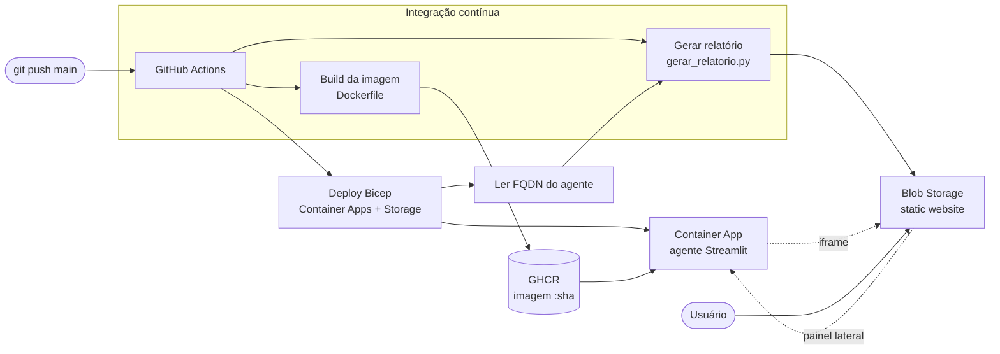
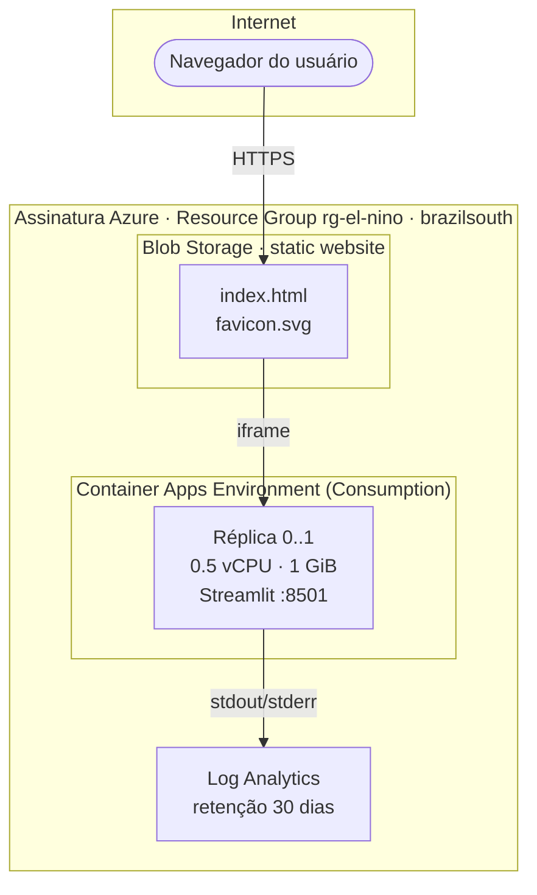

# Pipeline de Deploy — El Niño no Microsoft Azure

Documento de arquitetura e implantação do serviço **El Niño** (relatório estático + agente conversacional Streamlit) no Microsoft Azure, otimizado para **custo-benefício**.

---

## 1. Resumo executivo

O projeto tem **duas cargas com naturezas opostas**, e é isso que define a arquitetura:

| Carga | Natureza | Requisito de runtime |
|---|---|---|
| `relatorio_el_nino.html` + `favicon.svg` | Estático puro | Nenhum — só servir arquivos |
| `app_el_nino.py` (Streamlit) | Processo persistente com **WebSocket** | Container com processo vivo |

> **Ponto-chave:** o agente Streamlit **não roda em serverless** (Azure Functions, Logic Apps, Container Apps Jobs). Ele mantém uma conexão WebSocket aberta por sessão, então precisa de um runtime de longa duração.

**Arquitetura escolhida:**

- **Azure Blob Storage — static website** → hospeda o relatório (HTTPS, endpoint `*.web.core.windows.net`).
- **Azure Container Apps (Consumption, `minReplicas: 0`)** → hospeda o agente, com **escala para zero**.
- **GitHub Container Registry (público)** → registra a imagem, evitando o custo do Azure Container Registry.
- **GitHub Actions + Bicep** → CI/CD e infraestrutura como código.

**Custo estimado em regime de baixo tráfego: ≈ US$ 0/mês** (dentro das franquias gratuitas).

> **Restrição da assinatura (Azure for Students):** uma política da assinatura limita o deploy a um conjunto fixo de regiões — `eastus`, `canadacentral`, `chilecentral`, `mexicocentral` e `brazilsouth`. O **Static Web Apps não existe em nenhuma delas**, então o relatório é servido por um **static website do Blob Storage** (disponível em todas as regiões). Todo o deploy usa **brazilsouth**.

---

## 2. Fluxo do pipeline



**Ordem de dependência crítica:** o relatório precisa da URL pública do agente *antes* de ser gerado (ela entra no `<iframe>`). Por isso o job do site lê o FQDN via `az containerapp show` e injeta em `ELNINO_AGENT_URL`.

---

## 3. Arquitetura em execução



Sem VNet, sem banco, sem chaves de API: o agente é **100% offline** e a única fonte de dados é o `saida/facts.json` embutido na imagem.

---

## 4. Decisões de custo-benefício

### Serviços descartados (e por quê)

| Serviço | Custo aproximado | Motivo da recusa |
|---|---|---|
| **Azure Static Web Apps (Free)** | US$ 0 | Bloqueado pela política de regiões da assinatura (não existe em `brazilsouth` nem nas demais regiões permitidas) |
| **AKS** | US$ 70+/mês (nó mínimo) | Orquestração de cluster é desproporcional a 1 container |
| **App Service B1** | ~US$ 13/mês sempre ligado | Cobra 24/7 mesmo com acesso esporádico |
| **App Service F1 (Free)** | US$ 0 | Sem domínio próprio/SSL e limite de 60 min de CPU/dia |
| **Azure Container Instances** | US$ 35+/mês | Não escala para zero — cobra o tempo todo ligado |
| **Azure Functions / Logic Apps** | US$ 0 | Não suportam WebSocket persistente do Streamlit |
| **Azure Container Registry (Basic)** | ~US$ 5/mês | O **GHCR** faz o mesmo de graça para imagens públicas |
| **Azure Blob Storage (CSVs brutos)** | ~US$ 0,02/GB | O artefato final (`facts.json`) já é pequeno; guardar 600+ CSVs é desnecessário |

### E a escolha do `minReplicas`?

| Configuração | Experiência | Custo mensal |
|---|---|---|
| `minReplicas: 0` (escala para zero) | 1º acesso espera ~15–30 s (cold start); seguintes são instantâneos | **≈ US$ 0** (franquia cobre) |
| `minReplicas: 1` (sempre ligado) | Sempre instantâneo | **≈ US$ 35** |

0,5 vCPU + 1 GiB contínuos custam cerca de US$ 0,000015/s ≈ **US$ 39/mês**; a franquia mensal (180.000 vCPU-s) cobre apenas ~100 h. Por isso **`minReplicas: 0` é a decisão de custo-benefício** para tráfego esporádico.

### Franquias que zeram a conta

| Recurso | Franquia mensal gratuita |
|---|---|
| Container Apps — vCPU | 180.000 vCPU-segundos |
| Container Apps — memória | 360.000 GiB-segundos |
| Container Apps — requisições | 2 milhões |
| Log Analytics | 5 GB de ingestão |
| Blob Storage LRS (static website) | cobrança por GB armazenado/transferido — centavos para este volume |
| GHCR (repositório público) | Ilimitado |

---

## 5. Estrutura do repositório

```
el-nino/
├─ app_el_nino.py               # agente Streamlit
├─ gerar_relatorio.py           # gera o HTML
├─ requirements.txt
├─ favicon.svg
├─ saida/facts.json             # artefato de dados (vai para a imagem)
├─ Dockerfile                   # NOVO
├─ .dockerignore                # NOVO
├─ .gitignore                   # NOVO
└─ infra/
   └─ main.bicep                # NOVO
└─ .github/workflows/
   ├─ agent.yml                 # NOVO — build + deploy do agente
   └─ site.yml                  # NOVO — build + deploy do relatório
```

> **Importante:** as pastas `2024/`, `2025/`, `2026/` e os `.zip` **não entram no Git**. São centenas de MB de dados brutos e o deploy não os usa.

---

## 6. `.gitignore` e `.dockerignore`

`.gitignore`:

```gitignore
# Dados brutos do INMET (não vão para o Git)
2024/
2025/
2026/
*.zip
2024.zip
2025.zip
2026.zip

# Artefatos de runtime local
*.log
publicar.out.log
publicar.err.log
__pycache__/
.venv/
.venv*/
*.pyc

# Túneis locais
.cloudflared/
```

`.dockerignore`:

```dockerignore
# Contexto de build enxuto: apenas o que o agente precisa em runtime.
*
!app_el_nino.py
!requirements.txt
!favicon.svg
!saida
saida/*.csv
```

---

## 7. Dockerfile

O Streamlit precisa escutar em `0.0.0.0` e na porta que o Azure injeta via `$PORT`:

```dockerfile
# syntax=docker/dockerfile:1
FROM python:3.12-slim

ENV PYTHONUNBUFFERED=1 \
    PIP_NO_CACHE_DIR=1 \
    STREAMLIT_SERVER_HEADLESS=true \
    STREAMLIT_BROWSER_GATHER_USAGE_STATS=false \
    PORT=8501

WORKDIR /app

# Camada de dependências primeiro (melhor cache de build)
COPY requirements.txt .
RUN pip install --no-cache-dir -r requirements.txt

# Código + dados. O caminho relativo saida/ é o esperado por app_el_nino.py,
# e favicon.svg é usado como page_icon no st.set_page_config.
COPY app_el_nino.py   ./app_el_nino.py
COPY favicon.svg      ./favicon.svg
COPY saida/facts.json ./saida/facts.json

EXPOSE 8501

# CORS/XSRF desligados: obrigatório para o agente abrir dentro do <iframe> do relatório
CMD ["sh", "-c", "streamlit run app_el_nino.py \
  --server.port=${PORT} \
  --server.address=0.0.0.0 \
  --server.headless=true \
  --server.enableCORS=false \
  --server.enableXsrfProtection=false"]
```

---

## 8. Infraestrutura como código — `infra/main.bicep`

Escolhi **Bicep** em vez de Terraform pelo melhor custo-benefício operacional: é nativo do Azure e **não exige um backend de state** (que exigiria uma Storage Account extra). Se preferir Terraform, a tradução é direta.

```bicep
targetScope = 'resourceGroup'

@description('Prefixo dos nomes dos recursos')
param prefix string = 'elnino'

@description('Região. Restrita pela política da assinatura (ver seção 1)')
@allowed([
  'eastus'
  'canadacentral'
  'chilecentral'
  'mexicocentral'
  'brazilsouth'
])
param location string = 'brazilsouth'

@description('Imagem do agente no registry')
param image string = 'ghcr.io/SEU_USUARIO/el-nino-agent:latest'

@description('vCPU por réplica (0.5 = opção mais barata)')
param cpu string = '0.5'

@description('Memória por réplica (precisa casar com a vCPU)')
param memory string = '1Gi'

@description('Nome do Storage Account do relatório (globalmente único)')
param storageName string = 'elninosite561926'

var logsName  = '${prefix}-logs'
var envName   = '${prefix}-env'
var agentName = '${prefix}-agent'

// ---------------------------------------------------------------- Logs
resource logs 'Microsoft.OperationalInsights/workspaces@2023-09-01' = {
  name: logsName
  location: location
  properties: {
    retentionInDays: 30          // menor retenção = menor custo
    sku: { name: 'PerGB2018' }
  }
}

// ---------------------------------------------------- Container Apps Env
resource env 'Microsoft.App/managedEnvironments@2024-03-01' = {
  name: envName
  location: location
  properties: {
    appLogsConfiguration: {
      destination: 'log-analytics'
      logAnalyticsConfiguration: {
        customerId: logs.properties.customerId
        sharedKey: logs.listKeys().primarySharedKey
      }
    }
  }
}

// ------------------------------------------------ Agente (Streamlit)
resource agent 'Microsoft.App/containerApps@2024-03-01' = {
  name: agentName
  location: location
  properties: {
    managedEnvironmentId: env.id
    configuration: {
      ingress: {
        external: true
        targetPort: 8501
        transport: 'auto'                    // HTTP + WebSocket
        allowInsecure: false                 // força HTTPS
      }
    }
    template: {
      scale: {
        minReplicas: 0                       // escala para zero => custo ~US$ 0
        maxReplicas: 1                       // réplica única: sessão Streamlit consistente
        rules: [
          {
            name: 'http-concorrencia'
            http: { metadata: { concurrentRequests: '25' } }
          }
        ]
      }
      containers: [
        {
          name: 'agent'
          image: image
          resources: {
            cpu: json(cpu)
            memory: memory
          }
          env: [{ name: 'PORT', value: '8501' }]
          // O Streamlit expõe /_stcore/health — evita receber tráfego antes de estar pronto
          probes: [
            {
              type: 'startup'
              httpGet: { path: '/_stcore/health', port: 8501 }
              initialDelaySeconds: 5
              periodSeconds: 5
              failureThreshold: 30
            }
            {
              type: 'liveness'
              httpGet: { path: '/_stcore/health', port: 8501 }
              initialDelaySeconds: 15
              periodSeconds: 20
              failureThreshold: 3
            }
          ]
        }
      ]
    }
  }
}

// ---------------------------------------- Storage Account (relatório)
// O Static Web Apps não existe em nenhuma das regiões permitidas pela política
// da assinatura, então o relatório vai para um static website do Blob Storage.
resource storage 'Microsoft.Storage/storageAccounts@2023-05-01' = {
  name: storageName
  location: location
  kind: 'StorageV2'
  sku: { name: 'Standard_LRS' }              // camada mais barata
  properties: {
    allowBlobPublicAccess: true              // necessário para servir o site estático
    supportsHttpsTrafficOnly: true
    minimumTlsVersion: 'TLS1_2'
    accessTier: 'Hot'
  }
}

// O static website é habilitado por CLI (az storage account blob-service-properties
// update --enable-static-website), pois o nome das sub-propriedades varia entre
// api-versions e o provedor rejeita a forma enviada pelo Bicep. Fica no site.yml.

// ---------------------------------------------------------------- Saídas
output agentFqdn string = agent.properties.configuration.ingress.fqdn
output siteUrl string = storage.properties.primaryEndpoints.web
output storageAccountName string = storage.name
output storageAccountId string = storage.id
output logAnalyticsId string = logs.id
```

> **Nota de implementação:** a sub-propriedade `staticWebsite` do `blobService` aparece com nomes diferentes conforme a `api-version` (`defaultIndexDocumentPath`/`errorDocument404Path` nas novas, `indexDocument`/`errorDocument404Path` nas antigas). Para evitar o erro `BCP037` e a rejeição do provedor, essa configuração **não** é feita no Bicep — o workflow `site.yml` a habilita via CLI a cada execução (operação idempotente).

---

## 9. CI/CD — GitHub Actions

### 9.1 `.github/workflows/agent.yml` (build + deploy do agente)

```yaml
name: deploy-agent

on:
  push:
    branches: [main]
    paths:
      - 'app_el_nino.py'
      - 'favicon.svg'
      - 'saida/facts.json'
      - 'requirements.txt'
      - 'Dockerfile'
      - 'infra/main.bicep'
      - '.github/workflows/agent.yml'
  workflow_dispatch:

env:
  IMAGE: ghcr.io/${{ github.repository_owner }}/el-nino-agent

jobs:
  build:
    runs-on: ubuntu-latest
    permissions:
      contents: read
      packages: write
    steps:
      - uses: actions/checkout@v4

      - uses: docker/setup-buildx-action@v3

      - uses: docker/login-action@v3
        with:
          registry: ghcr.io
          username: ${{ github.actor }}
          password: ${{ secrets.GITHUB_TOKEN }}

      - uses: docker/build-push-action@v6
        with:
          context: .
          push: true
          tags: |
            ${{ env.IMAGE }}:${{ github.sha }}
            ${{ env.IMAGE }}:latest
          cache-from: type=gha
          cache-to: type=gha,mode=max

  deploy:
    needs: build
    runs-on: ubuntu-latest
    steps:
      - uses: actions/checkout@v4

      - uses: azure/login@v2
        with:
          creds: ${{ secrets.AZURE_CREDENTIALS }}

      # Provisiona/atualiza toda a infraestrutura (idempotente)
      - name: Provisionar infraestrutura
        run: |
          az deployment group create \
            --resource-group ${{ vars.AZURE_RG }} \
            --template-file infra/main.bicep \
            --parameters image=${{ env.IMAGE }}:${{ github.sha }} \
            --query properties.outputs -o json

      # Garante que a réplica use exatamente a imagem recém-construída
      - name: Publicar nova revisão
        run: |
          az containerapp update \
            --name elnino-agent \
            --resource-group ${{ vars.AZURE_RG }} \
            --image ${{ env.IMAGE }}:${{ github.sha }} \
            --query properties.latestRevisionName -o tsv
```

### 9.2 `.github/workflows/site.yml` (build + deploy do relatório)

```yaml
name: deploy-site

on:
  push:
    branches: [main]
    paths:
      - 'gerar_relatorio.py'
      - 'saida/facts.json'
      - 'favicon.svg'
      - '.github/workflows/site.yml'
  workflow_dispatch:

env:
  STORAGE_ACCOUNT: elninosite561926

jobs:
  deploy:
    runs-on: ubuntu-latest
    steps:
      - uses: actions/checkout@v4

      - uses: actions/setup-python@v5
        with:
          python-version: '3.12'

      - uses: azure/login@v2
        with:
          creds: ${{ secrets.AZURE_CREDENTIALS }}

      # 1) Descobre a URL pública ATUAL do agente
      - name: Ler FQDN do agente
        id: agent
        run: |
          FQDN=$(az containerapp show \
            --name elnino-agent \
            --resource-group ${{ vars.AZURE_RG }} \
            --query properties.configuration.ingress.fqdn -o tsv)
          echo "url=https://$FQDN/" >> "$GITHUB_OUTPUT"

      # 2) Gera o HTML já com o iframe apontando para o agente
      - name: Gerar relatório
        env:
          ELNINO_AGENT_URL: ${{ steps.agent.outputs.url }}
        run: |
          pip install -r requirements.txt
          python gerar_relatorio.py

      # 3) O static website exige index.html na raiz do artefato
      - name: Preparar artefato
        run: |
          mkdir -p dist
          cp relatorio_el_nino.html dist/index.html
          cp favicon.svg dist/favicon.svg

      # 4) Habilita o static website (idempotente). O Bicep não gerencia essa
      #    configuração porque o nome das sub-propriedades varia entre api-versions.
      - name: Habilitar static website
        run: |
          az storage account blob-service-properties update \
            --resource-group ${{ vars.AZURE_RG }} \
            --account-name ${{ env.STORAGE_ACCOUNT }} \
            --enable-static-website \
            --index-document index.html \
            --404-document index.html

      # 5) Publica no container $web, que é o root do static website
      - name: Publicar no static website
        run: |
          az storage blob upload-batch \
            --account-name ${{ env.STORAGE_ACCOUNT }} \
            --auth-mode login \
            --destination '$web' \
            --source dist \
            --overwrite \
            --content-cache-control 'public, max-age=300'

      - name: Exibir URL pública
        run: |
          az storage account show \
            --name ${{ env.STORAGE_ACCOUNT }} \
            --resource-group ${{ vars.AZURE_RG }} \
            --query properties.primaryEndpoints.web -o tsv
```

> O `--auth-mode login` usa a identidade do Service Principal autenticado no job, então ele precisa do papel **Storage Blob Data Contributor** no Storage Account (ver seção 10).

---

## 10. Bootstrap (execução única, manual)

```bash
# 0) Login e extensões
az login
az extension add --name containerapp --upgrade
az provider register --namespace Microsoft.App
az provider register --namespace Microsoft.Storage
az provider register --namespace Microsoft.OperationalInsights

# 1) Resource Group (o RG pode ficar em qualquer região; só os recursos são restritos)
az group create --name rg-el-nino --location eastus2

# 2) Provisionar tudo (primeira vez; usa a imagem :latest do GHCR)
az deployment group create \
  --resource-group rg-el-nino \
  --template-file infra/main.bicep \
  --parameters image=ghcr.io/SEU_USUARIO/el-nino-agent:latest

# 3) Guardar as URLs resultantes
az deployment group show -g rg-el-nino -n main \
  --query properties.outputs -o json

# 4) Credencial de deploy -> secret AZURE_CREDENTIALS no GitHub.
#    ATENÇÃO: --sdk-auth está obsoleto (emite WARNING) mas ainda é o formato
#    consumido pelo azure/login@v2. Filtre o JSON a partir do primeiro "{".
az ad sp create-for-rbac \
  --name gh-el-nino \
  --role contributor \
  --scopes /subscriptions/<SUBSCRIPTION_ID>/resourceGroups/rg-el-nino \
  --json-auth

# 5) O site.yml publica blobs como a identidade do SP (--auth-mode login),
#    então o papel Contributor (que é de plano de controle) NÃO basta:
az role assignment create \
  --assignee <CLIENT_ID_DO_SP> \
  --role "Storage Blob Data Contributor" \
  --scope /subscriptions/<SUBSCRIPTION_ID>/resourceGroups/rg-el-nino/providers/Microsoft.Storage/storageAccounts/elninosite561926
```

No GitHub, configure:

| Tipo | Nome | Valor |
|---|---|---|
| Variable | `AZURE_RG` | `rg-el-nino` |
| Secret | `AZURE_CREDENTIALS` | saída JSON do passo 4 (formato sdk-auth) |

> A imagem no GHCR precisa estar **pública** para o Container Apps puxá-la sem credenciais. Se preferir privada, adicione `--registry-username/--registry-password` no `az containerapp update`.

---

## 11. Operação

```bash
# Logs em tempo real do agente
az containerapp logs show -n elnino-agent -g rg-el-nino --follow

# Estado da escala (réplicas ativas)
az containerapp revision list -n elnino-agent -g rg-el-nino -o table

# Rollback instantâneo: revisões são imutáveis
az containerapp revision list -n elnino-agent -g rg-el-nino --query "[].name" -o tsv
az containerapp ingress traffic set -n elnino-agent -g rg-el-nino \
  --revision-weight <REVISAO_ANTERIOR>=100

# Custo acumulado do mês
az consumption usage list --query "[?contains(instanceName,'elnino')]"
```

### Domínio próprio e HTTPS

- **Relatório (Blob Storage static website):** o endpoint `https://<conta>.zNN.web.core.windows.net/` já tem HTTPS. Para domínio próprio, use **Azure CDN** (ou Front Door) na frente do container `$web` — o static website em si não suporta domínio customizado diretamente. Atenção: a zona (`z15`, `z13`, ...) é atribuída pela Azure e muda por conta.
- **Agente (Container Apps):** *Custom domains* com certificado gerenciado gratuito; aponte `app.seudominio.com` para o FQDN do agente.

### Cold start

Com `minReplicas: 0`, o primeiro acesso após ~15 min de inatividade leva de 15 a 30 s. Se isso for inaceitável em uma apresentação, suba temporariamente:

```bash
az containerapp update -n elnino-agent -g rg-el-nino --min-replicas 1
# ... e volte para 0 depois, para não pagar ~US$ 35/mês
az containerapp update -n elnino-agent -g rg-el-nino --min-replicas 0
```

---

## 12. Checklist de implantação

- [ ] Conta Azure (Azure for Students dá US$ 100 de crédito sem cartão)
- [ ] Confirmar que a região escolhida está entre as permitidas pela política da assinatura (`az policy assignment list` / teste com um deploy pequeno)
- [ ] Repositório no GitHub e imagens públicas habilitadas no GHCR
- [ ] `.gitignore` aplicado — confirmar que os CSVs **não** aparecem no `git status`
- [ ] `Dockerfile` presente e build local validado (`docker build -t el-nino-agent .`)
- [ ] `saida/facts.json` versionado
- [ ] `az group create` executado
- [ ] Deploy do Bicep executado (bootstrap)
- [ ] Service Principal criado com **Contributor** (RG) **e** **Storage Blob Data Contributor** (Storage Account)
- [ ] Secrets/variables configurados no GitHub (`AZURE_CREDENTIALS`, `AZURE_RG`)
- [ ] Primeiro push na `main` — os dois workflows (`agent` e `site`) verdes
- [ ] Agente com `/_stcore/health` = 200 e revisão `Healthy`
- [ ] Blob Storage com static website habilitado (`index.html` + `favicon.svg` no `$web`)
- [ ] Relatório abrindo e o painel do agente carregando **sem erro de CORS/iframe**

---

## 13. Quando mudar de estratégia

| Se... | Ação |
|---|---|
| O tráfego crescer e o cold start incomodar | `minReplicas: 1` nas horas de pico (~US$ 35/mês) |
| Precisar reprocessar os CSVs brutos na nuvem | Mover as pastas de CSV para Azure Blob + runner no CI |
| O `facts.json` passar de dezenas de MB | Parar de embutir na imagem e montar Azure Files |
| Precisar de ambientes `dev`/`prod` | Duplicar o `main.bicep` com `prefix` e RG distintos |
| Quiser eliminar o custo de Log Analytics | Baixar a retenção para 7 dias e filtrar logs do Streamlit |
