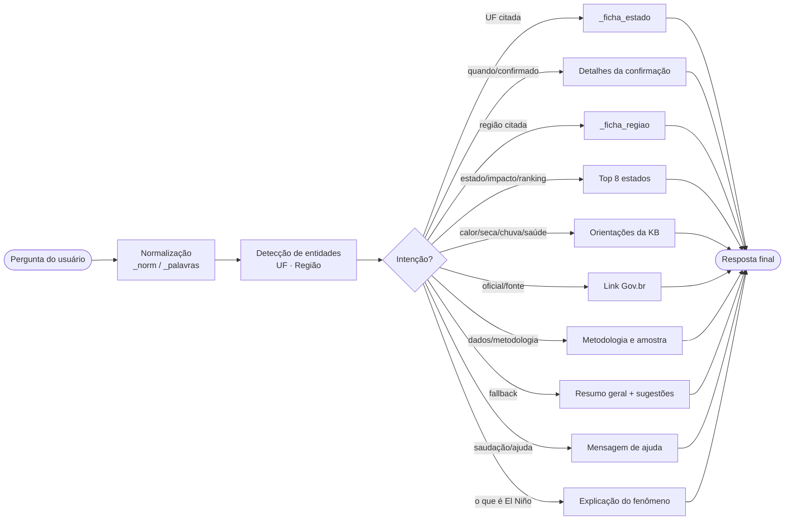
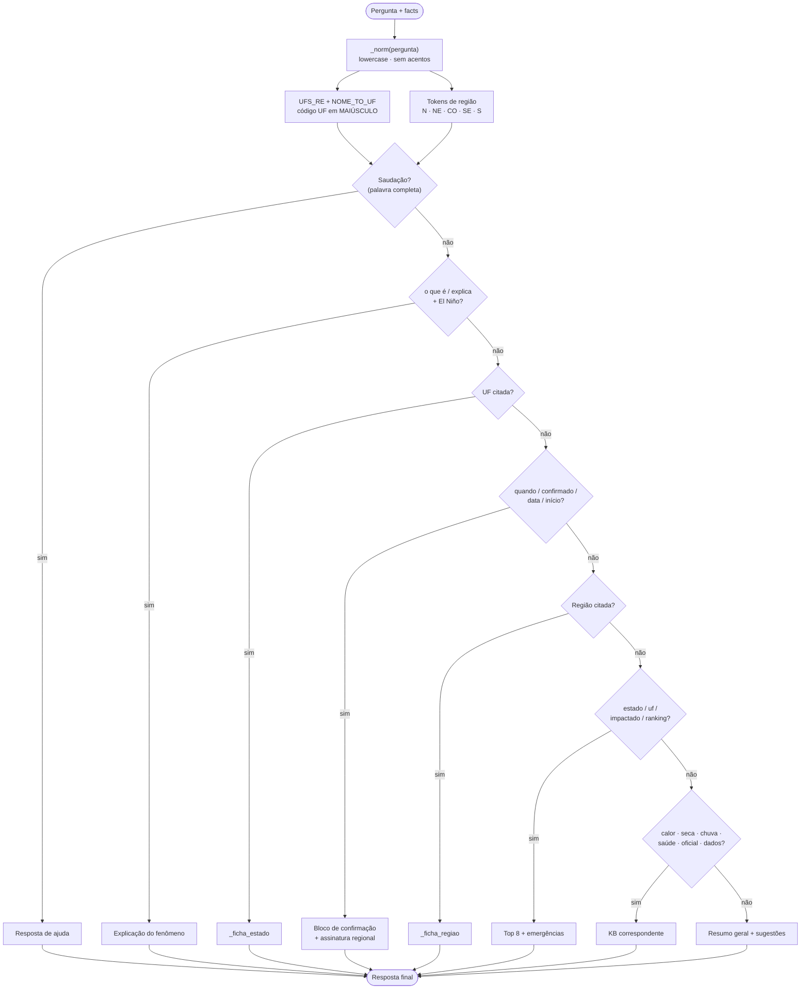
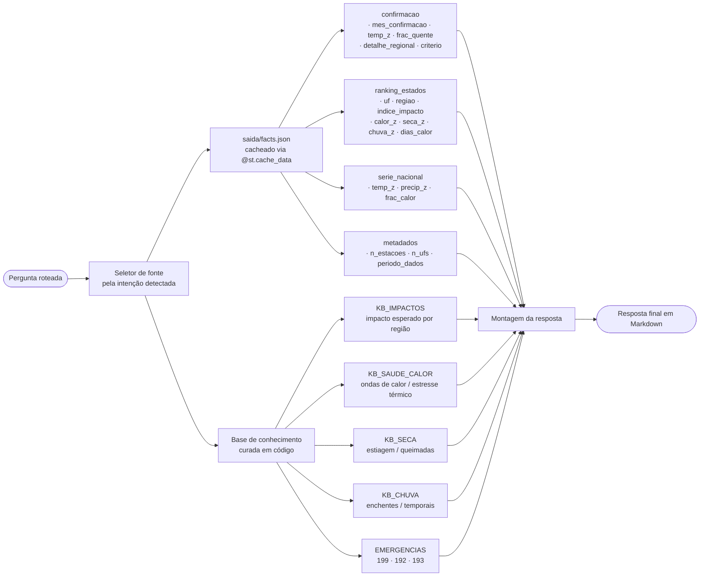
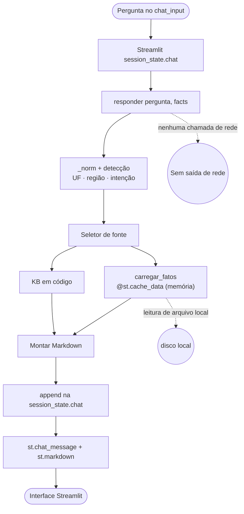

# Documentação do Agente El Niño

> Agente conversacional **100% offline** (sem chamadas a APIs de LLM) que responde dúvidas sobre a análise do fenômeno El Niño no Brasil com base em dados das estações automáticas do INMET.

---

## 1. Visão geral

O agente foi implementado em `app_el_nino.py` (Streamlit) e consome apenas a saída pré-processada de `analise_el_nino.py` (`saida/facts.json`) somada a uma **base de conhecimento curada em código** (orientações de saúde/proteção e impactos regionais).

Não há orquestração multi-agente remota nem serviços externos: o "roteamento" é feito por uma função de regra (`responder()`) que classifica a intenção do usuário e monta a resposta a partir de fontes locais.



---

## 2. Roteamento do agente (responder)

A função `responder(pergunta, f)` segue uma **cadeia de regras em ordem de prioridade**. A primeira regra que casa com a pergunta vence.



### Ordem de prioridade (por que essa sequência?)

1. **Saudação/ajuda** — comparada por **palavra completa** (`_palavras`) para evitar falso positivo em "foi", "coisa", etc.
2. **Definição** ("o que é El Niño") — antes das consultas de dado, pois é texto fixo.
3. **UF citada** — a ficha de estado é a resposta mais específica; deve vencer o ranking genérico.
4. **Confirmação** ("quando foi confirmada?") — consulta o bloco `confirmacao` do `facts.json`.
5. **Região citada** — vem antes do ranking genérico para que "impactos no Nordeste?" retorne a ficha regional.
6. **Ranking de estados** — consulta genérica sobre impactos.
7. **Temas de orientação** (calor, seca, chuva, saúde) — buscam a KB curada.
8. **Fonte oficial / metodologia** — perguntas sobre dados e links.
9. **Fallback** — resumo geral + sugestões de perguntas.

---

## 3. Recuperação de conhecimento (RAG local)

O agente não usa embeddings nem vetor store. A "recuperação" é **seletiva e determinística**: a regra de roteamento escolhe qual fatia de `facts.json` e qual entrada da KB deve ser usada.



### Fontes de verdade

| Fonte | Tipo | Conteúdo |
|---|---|---|
| `saida/facts.json` | Calculado por `analise_el_nino.py` | Confirmação, ranking estadual, série nacional, metadados |
| `KB_IMPACTOS` | Curada (código) | Impacto esperado por região (S, N, NE, CO, SE) |
| `KB_SAUDE_CALOR` | Curada (código) | Orientações para ondas de calor |
| `KB_SECA` | Curada (código) | Orientações para seca/queimadas |
| `KB_CHUVA` | Curada (código) | Orientações para chuvas intensas |
| `EMERGENCIAS` | Curada (código) | Telefones: Defesa Civil 199, SAMU 192, Bombeiros 193 |
| `FONTE_OFICIAL` | Curada (código) | Link para o portal Gov.br/El Niño |

---

## 4. Fluxo de execução e observabilidade

Como o agente roda **localmente e sem serviços externos**, a "observabilidade" se reduz ao ciclo de vida do Streamlit e aos logs do processo. Cada pergunta é processada dentro da própria requisição do navegador.



### Pontos de rastreabilidade

- **`@st.cache_data(show_spinner=False)`**: `carregar_fatos` lê `saida/facts.json` uma única vez e mantém em cache por sessão do Streamlit.
- **`session_state.chat`**: todo o histórico da conversa vive apenas na sessão do navegador; ao fechar a aba, a conversa é perdida.
- **Sem logs persistentes**: o agente não grava perguntas nem respostas em disco. O único log é o `stdout` do processo Streamlit (erros de execução).
- **Privacidade**: nenhuma pergunta é enviada para APIs externas.

---

## 5. Interface (3 abas)

| Aba | Conteúdo |
|---|---|
| **Pergunte ao agente** | Chat com sugestões clicáveis e `chat_input` |
| **Dados e estados** | DataFrame do ranking, gráfico da série nacional, fração de estações com calor |
| **Guia de proteção** | Orientações de calor/seca/chuva + fonte oficial + emergências |

---

## 6. Como executar

```bash
# 1. Gera os fatos (se ainda não existir saida/facts.json)
python analise_el_nino.py

# 2. Sobe o agente
streamlit run app_el_nino.py
```

O agente fica disponível em `http://localhost:8501`.
